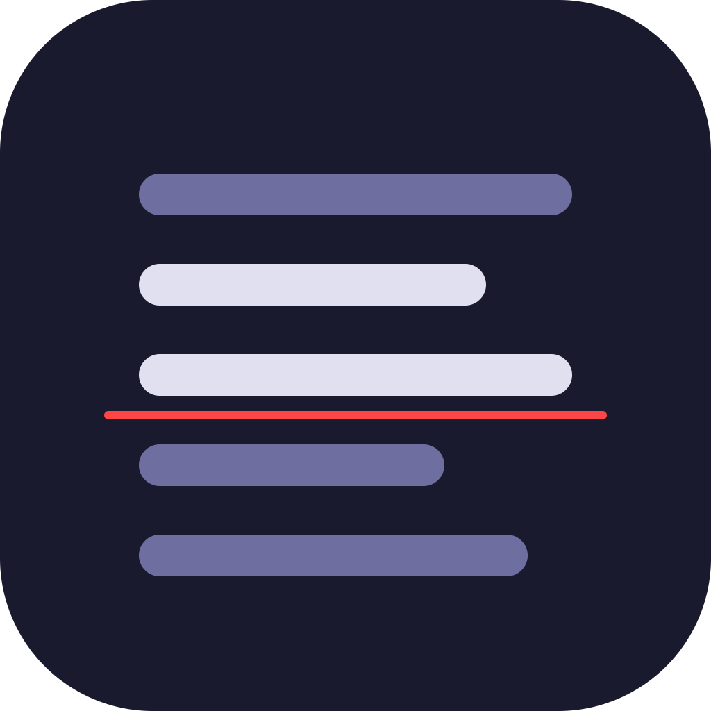

<div align="center">
  
  <h1>LocalCue</h1>
  <p>A local-network teleprompter: type on your computer, read from your phone's browser</p>

  
  
  
  

  <br /><br />

  <a href="https://github.com/Sinica15/localcue/releases/latest/download/LocalCue.pkg">
    
  </a>
</div>

---

No account, no cloud, no internet, nothing to install on the phone. The desktop app runs a small server on your Wi-Fi; scan its QR code and the phone becomes the prompter, controlled in real time from the computer. Mirror mode for beam-splitter teleprompters included.

A Tauri 2 / Rust port of [mdda/localcue](https://github.com/mdda/localcue) (Apache-2.0) — the interface, controls and character-offset position model come from there.

## Features

- **Double-click and go** — one app, no Python, Node.js or separate server
- **QR connection** — scan with any phone camera; the QR updates itself when your network address changes, with a network picker for multi-interface machines
- **Edit / Play modes** — a clear switch: edit the script, or present it with `Space` / arrow keys
- **Smooth, phone-side scrolling** — the animation runs on the phone, so Wi-Fi hiccups don't stutter it; auto-reconnect and state recovery after a drop
- **Several phones at once** — a live count of connected devices
- **Display controls** — font size, side margins, brightness, horizontal mirror and 90° rotation, applied live
- **Same line everywhere** — positions are character offsets, so the desktop editor and phones with different widths show the same text on the reading line
- **Native files** — Open / Save / Save As dialogs, autosave and restore after a restart
- **Keeps the phone awake** — Screen Wake Lock, with a silent-video fallback for plain http
- **Private by design** — LAN only, random access key in the QR link, phones are read-only

## Install

**macOS** — download the latest `.pkg` from [Releases](https://github.com/Sinica15/localcue/releases) and double-click it. (`.dmg` and `.app.zip` are there too; Apple Silicon build.)

> The app is not notarized. The `.pkg` installer handles Gatekeeper automatically, but on some Macs it still shows up as blocked. If you see **"LocalCue.pkg" was blocked to protect your Mac**, open **System Settings → Privacy & Security**, scroll to **Security** and click **Open Anyway**.

**Windows** — no prebuilt installer is published yet; build it from source (`npm run tauri build` produces an NSIS `.exe`) or run the *Build installers* workflow in the Actions tab.

First launch: the OS firewall asks whether LocalCue may accept incoming connections — click **Allow**, otherwise phones cannot connect.

If a phone's Chrome cannot open the link, it may be asking for the **Nearby devices** (local network) permission, or have *Always use secure connections* turned on — allow the permission, turn the setting off, and use the full `http://…` link from the QR dialog.

## Using it

1. Click **QR Code** and scan it with your phone (same Wi-Fi). Tap the phone once for fullscreen and to keep the screen on.
2. Type or open (`⌘O`) a script. Tune font size, margins, brightness, **Flip** (mirror) and **Rotate**.
3. Click **Play** to switch to presenting. Nothing moves until you press `Space`.

| Key (Play mode) | Action |
|-----------------|--------|
| `Space` | Start / pause the scrolling |
| `↓` / `↑` | Move the text one line down / up (never starts or stops playback) |
| `←` / `→` | Speed −5 / +5 |
| `Esc` | Pause and go back to editing |

| Key (anywhere) | Action |
|----------------|--------|
| `⌘O` / `Ctrl+O` | Open a script |
| `⌘S` / `Ctrl+S` | Save (add `Shift` for Save As) |
| Mouse wheel | Scroll the editor; phones follow (right side of the window = finer steps) |
| Click a line | Put it on the reading line on every device |

The reading line sits one third down the screen on both desktop and phone. The status in the corner shows `synced` / `connecting…` / `disconnected, retrying…`.

## Build from source

```bash
# requirements: Rust (stable), Node.js 20+, Xcode Command Line Tools (macOS) or MSVC build tools (Windows)
npm install
npm run tauri dev     # dev mode with hot reload
npm run release       # builds .app + .dmg + .pkg into releases/ (macOS)
npm run publish       # creates the GitHub release for the current version (needs gh)
```

Checks:

```bash
npm run build && npm run check:mobile
cd src-tauri && cargo fmt --check && cargo clippy --all-targets -- -D warnings && cargo test
```

UI without the native shell: `cargo run --example headless` in `src-tauri` (set `LOCALCUE_TOKEN` for a stable key, `LOCALCUE_DEBUG=1` to log sync traffic), then open `npm run dev`'s page at `http://localhost:1420/?ws=<desktop url printed by the example>`.

CI: `ci.yml` runs checks and tests on macOS and Windows; *Build installers* (manual) builds Apple Silicon, Intel and Windows installers as workflow artifacts.

## Security model

- The server binds **only** to `127.0.0.1` (the desktop window) and one private LAN address — never `0.0.0.0` — and rejects peers outside private/loopback ranges.
- Every page and WebSocket needs a random 128-bit key (in the QR link; kept between launches so home-screen shortcuts keep working). **New access key** in the QR dialog replaces it and disconnects phones.
- Only the local desktop window controls the prompter; phones are read-only. WebSocket `Origin` is checked and the phone page has a strict CSP.
- The HTTP server serves the phone page and its embedded scripts — no file-system access. Only the desktop window holds Tauri capabilities; file paths come from native dialogs only.

## Architecture

```
src-tauri/src/
  protocol.rs  WebSocket JSON messages        state.rs   authoritative state + validation
  hub.rs       routing, files, autosave       server.rs  Axum HTTP/WS, listeners, QR, key
  net.rs       interface discovery, LAN check files.rs   atomic file I/O, JSON persistence
  voice.rs     voice-follow feature flag      lib.rs     Tauri commands, autosave, lifecycle
shared/        textpos.js (char offset ⇄ pixels), wsclient.js (reconnecting WebSocket)
mobile/        phone page (embedded into the binary)
src/           desktop UI (Vite + TypeScript, no framework)
```

One authoritative state lives in `Hub`; a message from a client updates it and is broadcast to everyone **except the sender**, so position updates cannot loop. Socket.IO of the original was replaced by plain WebSockets (`{"t": "...", ...}`).

## Tech stack

| Layer | Tech |
|-------|------|
| Desktop shell | Tauri v2 |
| Server | Rust, Axum + Tokio (HTTP + WebSocket) |
| Desktop UI | TypeScript + Vite, no framework |
| Phone page | Plain JavaScript, served from the app |

## Planned

- **Voice-follow** — the original used Vosk + PulseAudio. A cross-platform port needs audio capture, a native speech engine and a model download plus microphone permissions on both systems; it is isolated behind `voice.rs` (`AVAILABLE = false`, reported as `capabilities.voice`) and no voice controls are shown. The matching algorithm is kept in `legacy/voice.py`.
- Notarized macOS builds and a signed Windows installer.
- Script size is capped at 5 million characters.

## License

Apache-2.0 — see `LICENSE` and `NOTICE`. Based on [LocalCue](https://github.com/mdda/localcue) by its authors.
